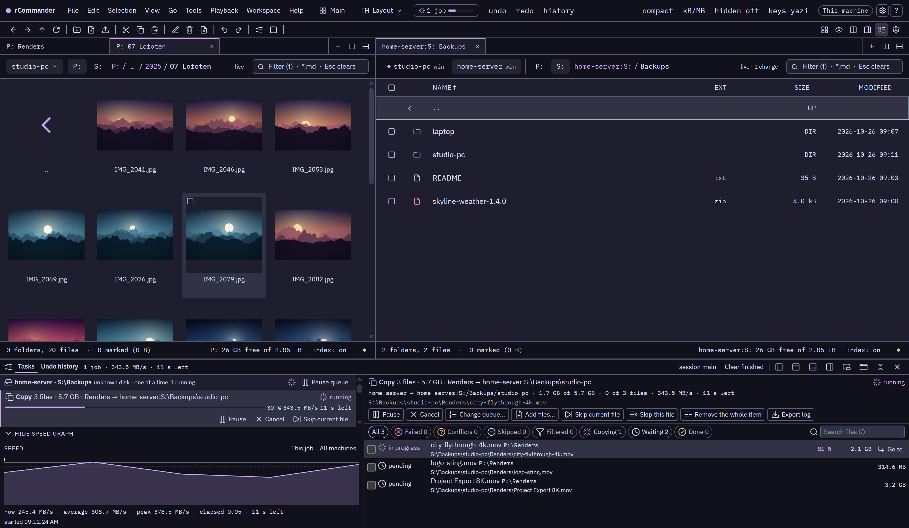
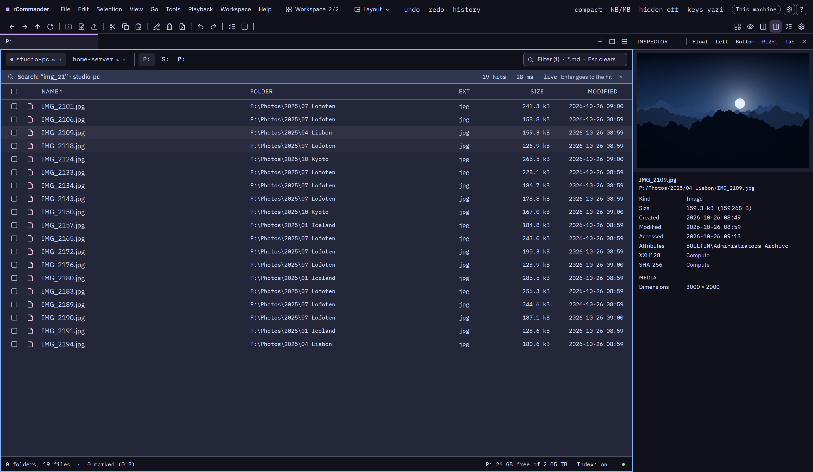
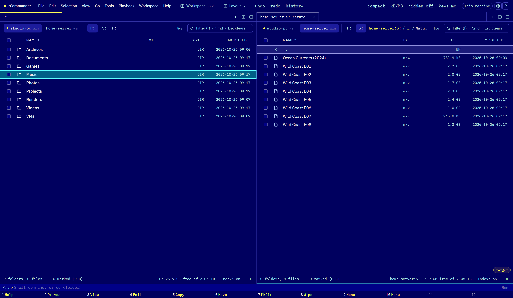
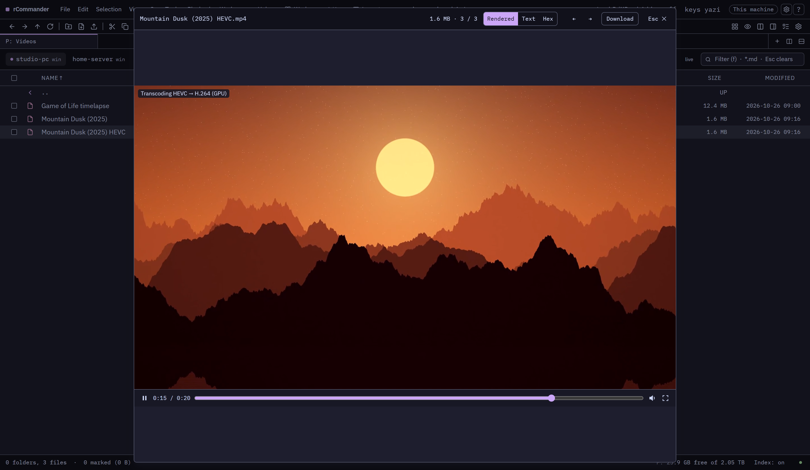
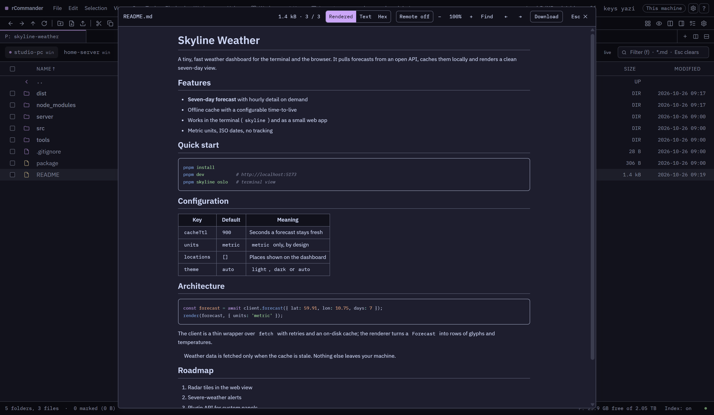
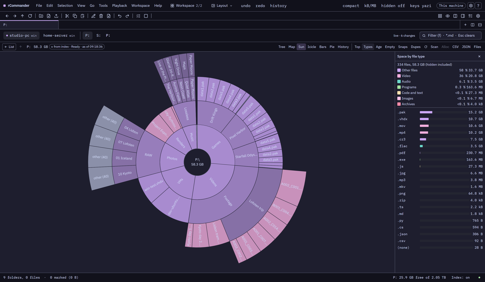

<div align="center">

# rCommander

### Every file on every computer you own. One window. Instantly.

**The file manager for people with more than one computer.**
Install it on your desktop, your laptop and your home server,
and each one opens the others' drives as if they were plugged in right here,
from any browser in the house, even on your phone.

[**Download**](../../releases/latest) · [Install guide](docs/install-and-test-guide.md) · [Report a bug](../../issues/new/choose)

&nbsp;



</div>

&nbsp;

---

&nbsp;

### All your machines, one file manager

Windows and Linux side by side, in the same panes.
Copy a folder from the laptop to the server with a keypress: the computers talk to each other directly,
your browser is not in the middle, and a copy that loses the network **picks up where it stopped**,
even after a restart.

### Search that does not make you wait

rCommander keeps an index of your drives and keeps it current as files change.
Type a name and the results are there while you are still typing, across the whole machine.



### Your keys, your way

Grew up on **Total Commander**? **Midnight Commander**? **Far**? Live in **yazi**, **ranger**, **nnn**, **lf**,
**vifm**? Prefer **Explorer**, **Directory Opus** or **VS Code**?
Pick a personality and rCommander takes on its keys, panes and look.
And everything also works with the mouse alone.



### Undo. Really.

Deleted the wrong folder? Moved a thousand photos into the wrong place? Renamed a whole album badly?
**Ctrl+Z.** Copies, moves, renames, deletes to the recycle bin, unpacked archives, whole scripts:
one step back, even when the files were on another computer.

### Opens everything

Videos that browsers refuse (MKV, HEVC, 10-bit, surround sound) play anyway,
converted on the fly, on the graphics card when there is one.
E-books that remember your page. Markdown and HTML rendered, code highlighted the way GitHub does it,
PDFs, photos with their camera details, music with its tags.
Zip, 7z, tar and rar open like folders, and you can copy files **into** a zip as if it were one.





### Work that does not get in your way

Big copies queue per disk, so two copies never fight over the same drive.
Pause one, reorder them, add more files to a copy that is already running.
Close the browser, restart the computer: the work carries on and finishes.

### See where your space went

Treemaps, sunbursts and bar charts of any folder, in seconds.
Find duplicates and clear them out safely. Take snapshots and see which folder grew since last month,
or compare a folder with its copy on another machine.



### And all the things a power user reaches for

Synchronise two folders, even on two computers. Multi-rename with counters, dates and photo details.
Create and verify checksum files. Convert videos, audio and images. Watch a folder and run a script
when files arrive. Play music to the speakers in any room. Install VS Code themes with one click.
Write your own commands in JavaScript.

### Yours. Only yours.

rCommander runs on your own computers. No cloud, no account, no subscription, nothing about your files
leaves your home. Friends and family can get a guest password that shows only the folders you share,
read-only.

&nbsp;

> **rCommander is young.** Version 0.1 is out for its first testers: expect rough edges, and please
> [tell us](../../issues/new/choose) what you find.

&nbsp;

---

This repository holds the **downloads, help and bug reports**. The source code is not public.

&nbsp;

## Download

Go to [**Releases**](../../releases/latest) and download two files into one folder:

- `rCommander-<version>.zip`
- `SHA256SUMS`

The same zip works on Windows and Linux.

&nbsp;

## Install

**Windows 10 / 11:** unzip, open PowerShell **as administrator** in the unzipped folder, and run:

```powershell
powershell -ExecutionPolicy Bypass -File .\setup.ps1 install -Lan
```

**Linux:** unzip, open a terminal in that folder, and run:

```bash
bash setup.sh install --lan
```

Then open <http://localhost:8223> in your browser.

Leave out `-Lan` / `--lan` if you only want to use rCommander on this one computer.
What it changes, and everything else step by step, is in the
[**install and test guide**](docs/install-and-test-guide.md).

The installer needs the .NET 10 runtime and offers to install it when it is missing.

&nbsp;

## Update and uninstall

Update: download the newer zip, unzip it, and run its `setup.ps1 update` (Linux: `setup.sh update`).
Your settings, bookmarks and index are kept.

Uninstall: run `setup.ps1 uninstall` from the installed program folder (Linux: `setup.sh uninstall`).
Add `-Purge` / `--purge` to delete your rCommander data as well.

Details: [install and test guide](docs/install-and-test-guide.md), Parts 4 and 5.

&nbsp;

## Bonus: The Long Walk

The landscapes in the screenshots above, as a pack of 24 wallpapers in 4K, with the story of the
seven-week hike it took to find them.
[**Download the wallpapers**](../../releases/tag/wallpapers-1)


&nbsp;

## Found a bug? Have an idea?

Open an [**issue**](../../issues/new/choose) and pick *Bug report* or *Idea*.

&nbsp;

## Privacy

rCommander runs on your own computers. It contacts the internet only to:

- check GitHub once a day for updates of the helper programs it manages (ffmpeg, mpv, 7-Zip…),
  and download them when you press Install;
- search and download themes from Open VSX when you open the theme gallery.

Nothing about your files is ever sent anywhere.
